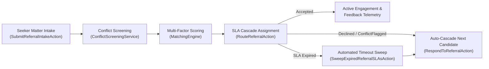

<p align="center">
  <picture>
    <source media="(prefers-color-scheme: dark)" srcset="https://github.com/MemberJunction/MJ/raw/main/MJ_logo_dark.png">
    <source media="(prefers-color-scheme: light)" srcset="https://github.com/MemberJunction/MJ/raw/main/MJ_logo.webp">
    
  </picture>
</p>

<h1 align="center">BizApps Referrals</h1>

<p align="center">
  <strong>Professional referral, verified member directory, conflict screening, and SLA cascade routing for the <a href="https://github.com/MemberJunction/MJ">MemberJunction</a> platform</strong>
</p>

<p align="center">
  <a href="#what-this-is--and-is-not">What this is</a> &middot;
  <a href="#installation">Install</a> &middot;
  <a href="#how-it-works">How it works</a> &middot;
  <a href="#what-you-get">What you get</a> &middot;
  <a href="#actions--operations">Actions</a> &middot;
  <a href="#angular-components--custom-forms">Angular UI</a> &middot;
  <a href="#metadata--seed-data">Metadata</a>
</p>

<p align="center">
  
  
  
  
  <a href="./LICENSE"></a>
</p>

---

Professional associations — bar associations, CPA societies, medical boards, engineering institutes, and trade networks — routinely manage member referrals through static directories, spreadsheets, or manual staff email chains. **BizApps Referrals** ("Find a Lawyer / Find a Pro") turns that workflow into a **verified, conflict-screened, SLA-governed referral engine** packaged as a single **MemberJunction Open App**.

Seekers describe their matter in plain language or structured filters; the matching engine scores eligible professionals across practice-area hierarchy, verified jurisdiction admissions, capacity headroom, and historical SLA responsiveness; conflict parties are screened before matter details are exposed; and deterministic SLA cascades automatically re-route declined, conflicted, or expired offers to the next-best candidate.

---

## What This Is — and Is Not

| ✅ This is | ❌ This is not |
|---|---|
| A **verified member directory & referral routing engine** (`__mj_BizAppsReferrals`) | A general-purpose CRM or lead-gen ad marketplace |
| **Explainable multi-factor matching** (`MatchingEngine`) across practice hierarchy, jurisdiction, capacity, and SLA history | An opaque black-box ranking widget with no audit trail |
| **Conflict-of-interest & SLA cascade governed** — `ConflictScreeningService`, `CascadeRoutingService`, and `SweepScheduler` | A manual "email 3 members and hope someone replies" listserv |
| **Tri-persona Angular workspace** — Seeker Intake, Member Pro Lead Inbox, and Association Ops Telemetry | A static read-only directory page |
| **Open App native** — composes cleanly with `BizApps Common` (Person/Org) and `BizApps Tasks` (follow-ups & escalations) | A siloed vertical database duplicating master people and tasks |

---

## Installation

BizApps Referrals is a [MemberJunction Open App](https://github.com/MemberJunction/MJ/tree/main/packages/OpenApp). Install it into any MJ environment using the [MJ CLI](https://github.com/MemberJunction/MJ/tree/main/packages/MJCLI):

```bash
mj app install https://github.com/MemberJunction/bizapps-referrals
```

This single command:

1. Fetches `mj-app.json` and validates MJ version compatibility (`>=6.2.1 <7.0.0`)
2. Resolves dependencies: [BizApps Common](https://github.com/MemberJunction/bizapps-common) and [BizApps Tasks](https://github.com/MemberJunction/bizapps-tasks)
3. Creates the `__mj_BizAppsReferrals` schema and deploys all 11 tables (including `ProfessionalCredential` and normalized `ProfessionalProfile.LicenseNumber`) via dual-dialect SQL Server & PostgreSQL Skyway migrations
4. Syncs application, entity, action, practice-area, jurisdiction, and referral-tier metadata
5. Installs and wires `@mj-biz-apps/referrals-server`, `@mj-biz-apps/referrals-entities-server`, and `@mj-biz-apps/referrals-ng`

### Managing an installed app

```bash
mj app list                           # See installed apps
mj app info mj-bizapps-referrals      # Show details and version
mj app upgrade mj-bizapps-referrals   # Upgrade to latest release
mj app disable mj-bizapps-referrals   # Temporarily disable
mj app enable mj-bizapps-referrals    # Re-enable
mj app remove mj-bizapps-referrals    # Uninstall (--keep-data to preserve schema)
```

---

## How It Works



1. **Intake & Screening**: A `ReferralRequest` captures matter summary, practice area, jurisdiction, urgency, budget band, and `ConflictCheckParty` records.
2. **Scoring & Ranking**: `MatchingEngine` evaluates active `ProfessionalProfile` records on practice-area match (exact + ancestor), verified `ProfessionalJurisdiction` standing, capacity (`ActiveCount < MaxActiveReferrals`), `ReferralTier` priority weight, and historical SLA responsiveness, emitting explainable `MatchRationaleJSON`.
3. **Deterministic Cascade**: `CascadeRoutingService` offers the referral to Candidate #1 with a computed `SLADeadlineAt`. If the professional declines, flags a conflict, or lets the SLA expire (`SweepScheduler` / `SweepExpiredReferralSLAsAction`), the system automatically advances `RouteSequence` to Candidate #2.

---

## What You Get

### 14 Database Tables (`__mj_BizAppsReferrals` schema)

| Category | Tables | Purpose |
|---|---|---|
| **Taxonomy & Tiers** | `PracticeArea`, `Jurisdiction`, `ReferralTier` | Hierarchical practice-area tree, geographic/bar jurisdictions, and SLA/cascade/escalation tier policies |
| **Directory & Credentials** | `ProfessionalProfile`, `ProfessionalPracticeArea`, `ProfessionalJurisdiction`, `ProfessionalCredential` | Member profiles linked to `Person`/`Organization`, practice proficiencies, capacity caps, verified license admissions, and normalized credentials |
| **Intake & Screening** | `ReferralRequest`, `ConflictCheckParty` | Seeker matter intake, urgency/budget metadata, source channel, and opposing/related parties for conflict checks |
| **Routing & Outcomes** | `ReferralAssignment`, `ReferralFeedback`, `ReferralOutcome` | Sequential cascade offers with `MatchScore`, `MatchRationaleJSON`, SLA deadlines, post-referral outcome ratings, and terminal completion records |
| **Escalation & Readiness** | `ReferralEscalation`, `ProfessionalAvailabilityWindow`, `ReciprocitySnapshot` | SLA warning/breach escalation events, recurring/date-range/blackout availability windows, and periodic give/receive reciprocity snapshots |

### 7 TypeScript Packages

| Package | NPM Name | Role |
|---|---|---|
| **Entities** | `@mj-biz-apps/referrals-entities` | CodeGen-generated strongly-typed entity classes and Zod schemas |
| **Core** | `@mj-biz-apps/referrals-core` | Pure domain engines: `MatchingEngine`, `ConflictScreeningService`, `CascadeRoutingService`, `ReferralTelemetry`, validation |
| **Entities Server** | `@mj-biz-apps/referrals-entities-server` | Authoritative server entity subclasses (`ConflictCheckPartyServerEntity`, `ProfessionalProfileServerEntity`, `ReferralRequestServerEntity`) |
| **Actions** | `@mj-biz-apps/referrals-actions` | Server `BaseAction` implementations + isomorphic `BaseRemotableOperation` client/server operations |
| **Server** | `@mj-biz-apps/referrals-server` | Server bootstrap (`LoadBizAppsReferralsServer`), `SweepScheduler`, and lifecycle probe endpoints |
| **Angular** | `@mj-biz-apps/referrals-ng` | Tri-persona Explorer application (`LoadBizAppsReferralsClient`) and `BaseFormPanel` custom entity form hero panels |
| **Integration Tests** | `@mj-biz-apps/referrals-integration-tests` | End-to-end lifecycle tests covering seeding, matching, conflict rejection, SLA timeout sweeps, and cascades |

---

## Actions & Operations

Every core workflow is exposed both as a MemberJunction Action (`@mj-biz-apps/referrals-actions`) and an isomorphic `BaseRemotableOperation`:

| Action / Operation | Purpose |
|---|---|
| `SubmitReferralIntakeAction` / `SubmitReferralIntakeOperation` | Creates a `ReferralRequest` + `ConflictCheckParty` rows and optionally triggers immediate matching & routing |
| `MatchProfessionalsAction` / `MatchProfessionalsOperation` | Scores and ranks eligible professionals with explainable `MatchRationaleJSON` |
| `RouteReferralAction` / `RouteReferralOperation` | Dispatches the next `ReferralAssignment` in sequence with an SLA deadline |
| `RespondToReferralAction` / `RespondToReferralOperation` | Atomically records `Accepted`, `Declined`, or `ConflictFlagged` and auto-cascades on non-acceptance |
| `SweepExpiredReferralSLAsAction` / `SweepExpiredReferralSLAsOperation` | Marks expired `Offered` assignments as `TimedOut` and cascades to the next ranked candidate |
| `MarkReferralInProgressAction` / `CompleteReferralAction` | Transactional, authorization-checked, idempotent lifecycle completion; the latter creates a `ReferralOutcome` |
| `SetAvailabilityWindowAction` | Creates/updates a `ProfessionalAvailabilityWindow` (Recurring / DateRange / Blackout) |
| `EvaluateEscalationsAction` / `AcknowledgeEscalationAction` / `ResolveEscalationAction` | SLA-warning/urgent-unassigned escalation evaluation and coordinator/admin-gated lifecycle transitions |
| `ReopenExhaustedReferralAction` | Admin-only reopen of an `Exhausted` request, excluding previously-assigned professionals |
| `RecomputeReciprocityAction` / `GetReciprocityScorecardAction` | Batch recompute and on-demand read of per-professional reciprocity scorecards |

---

## Angular Components & Custom Forms

`@mj-biz-apps/referrals-ng` registers a full Explorer application (**Referrals**) built exclusively with `--mj-*` semantic light/dark design tokens:

- **`ReferralsSeekerIntakeComponent`** (*Seeker Intake*): Natural-language matter intake bar, practice/jurisdiction/urgency filters, trust & SLA KPI strip, and ranked professional match cards with verified credential badges and match rationale.
- **`ReferralsProInboxComponent`** (*Pro Lead Inbox*): Incoming referral queue with live SLA countdown timers, `ConflictCheckParty` screening list, one-click `Accept` / `Flag Conflict` / `Decline` actions, and capacity controls.
- **`ReferralsOpsTelemetryComponent`** (*Ops Telemetry*): Association executive KPI strip, `Active Referral Dispatch Telemetry` table with cascade controls, and `Supply-Demand Gap Matrix`.
- **Custom Entity Forms (`BaseFormPanel`)**:
  - `ReferralRequestHeroPanel` — intake status, conflict screening summary, and `Candidate Cascade Ladder`
  - `ProfessionalProfileHeroPanel` — bar/license verification audit, capacity & routing policy, and historical acceptance/rating metrics

---

## Wave 2: Normalized Credentials & Pluggable Verification

- **Normalized Schema (`V202611141200`)**: Replaces the legacy profile-level license column with `ProfessionalProfile.LicenseNumber` and adds `[__mj_BizAppsReferrals].[ProfessionalCredential]` across both SQL Server (`migrations/`) and PostgreSQL (`migrations-pg/`), including views, CRUD procedures, and MJ entity metadata.
- **Pluggable Verification Providers (`@mj-biz-apps/referrals-core`)**: `ReferralCredentialService` supports `Manual` (coordinator/admin-verified with `ContextUser` derivation), `ExternalAction` (requires configured adapter or HMAC-SHA256 signed verification payload; fails closed), and `BizAppsCredentialingBridge` (dynamic discovery of `MJ_BizApps_Credentialing` entities with person-level subject matching and ambiguity fail-closed).
- **Credential Actions (`@mj-biz-apps/referrals-actions`)**: `Referrals.VerifyCredential`, `Referrals.SyncProfileCredentials`, and `Referrals.ListCredentialProviders`.
- **Explorer Workspace (`@mj-biz-apps/referrals-ng`)**: Includes `Directory & Pros` (`ReferralsCredentialDirectoryResource`), `BaseFormComponent` + `BaseFormPanel` registrations for all 11 entities, and `--mj-*` design token compliance.

---

## Wave 3 Slice 1: SLA Escalation, Lifecycle Completion & Capacity Readiness

- **Schema v1.2.0 (`V202611151000`)**: Adds `ReferralEscalation`, `ReferralOutcome`, `ProfessionalAvailabilityWindow`, and `ReciprocitySnapshot` across both SQL Server (`migrations/`) and PostgreSQL (`migrations-pg/`), plus additive escalation/readiness columns on `ReferralTier`, `ReferralRequest`, `ReferralAssignment` (widening `Status` to include `InProgress`/`Completed`), and `ProfessionalProfile`.
- **`CapacityReadinessService` (`@mj-biz-apps/referrals-core`)**: `ResolveEffectiveAvailability` layers explicit `ProfessionalAvailabilityWindow` records (Recurring / DateRange / Blackout) on top of `AvailabilityStatus`; `ComputeReadinessScore` produces a 5-factor 0-100 breakdown (Availability, Capacity, Responsiveness, Rating, Reciprocity); `ComputeSLADeadline` applies the tier's `UrgentSLAMultiplier` for `Urgent` referrals. `MatchingEngine` now disqualifies candidates outside their configured availability windows.
- **Lifecycle Completion (`CascadeRoutingService`)**: `MarkInProgress` and `CompleteReferral` are transactional, authorization-checked *before* any writes, and idempotent on repeat calls. `CompleteReferral` creates a `ReferralOutcome`, decrements `ActiveReferralCount` (never below 0), increments `TotalCompletedCount`, and recomputes a 90-day rolling `AverageResponseHours`. Cascade `CascadeOrder` numbering was fixed so conflict-rejected candidates are always numbered after eligible ones.
- **New Actions (`@mj-biz-apps/referrals-actions`)**: `Referrals.MarkReferralInProgress`, `Referrals.CompleteReferral`, `Referrals.SetAvailabilityWindow`.
- **Explorer Workspace (`@mj-biz-apps/referrals-ng`)**: `BaseFormComponent` + `BaseFormPanel` registrations for all 15 entities.

---

## Wave 3 Slice 2: Escalation Engine, Reopen & Reciprocity Scorecards

- **Schema v1.2.1 (`V202611152000`)**: Additive escalation-lifecycle columns on `ReferralEscalation` (`DedupKey`, `LinkedTaskID`, `AcknowledgedByPersonID`, `ResolvedByPersonID`, `ResolutionNotes`; `TriggerType` widened to 6 values — `SLAWarning`, `SLABreach`, `ManualEscalation`, `CapacityExhausted`, `CascadeExhausted`, `UrgentUnassigned` — and `Status` widened to 4 — `Open`, `Acknowledged`, `Resolved`, `Dismissed`), `FeeAmount` on `ReferralOutcome`, and full scorecard metrics (`AcceptedCount`, `ResolvedCount`, `SLABreachCount`, `AcceptanceRate`, `MedianResponseHours`, `AttributedFeeTotal`, with a unique index per profile/period) on `ReciprocitySnapshot`.
- **`SlaEscalationService` (`@mj-biz-apps/referrals-core`)**: `EvaluateEscalations` raises SLA-warning and urgent-unassigned escalations; `RaiseEscalation` is idempotent by `DedupKey` and caps `EscalationLevel` at the tier's `MaxEscalationLevel`; `AcknowledgeEscalation` / `ResolveEscalation` / `DismissEscalation` enforce coordinator/admin authorization *before* any writes. Notifications are dispatched through a pluggable `BaseEscalationNotifier` (`None`, `BizAppsTasks` — the latter discovers the sibling BizApps Tasks schema at runtime via `provider.Entities` and raw parameterized SQL, with no static dependency on that package).
- **`CascadeRoutingService.ReopenExhaustedRequest`**: Admin-only reopen of an `Exhausted` referral — re-runs matching excluding every previously-assigned professional, optionally expanding to the parent `PracticeArea`, and auto-resolves the open `CascadeExhausted` escalation when a new candidate is found.
- **`ReciprocityScorecardService` (`@mj-biz-apps/referrals-core`)**: `ComputeScorecard` computes `ReciprocityIndex = round((Sent + 1) / (Accepted + 1), 3)` plus Sent/Received/Accepted/Resolved/SLABreachCount/AcceptanceRate/MedianResponseHours/AttributedFeeTotal; `RecomputeSnapshots` batch-upserts `ReciprocitySnapshot` rows per professional per UTC calendar quarter and updates `ProfessionalProfile.ReciprocityIndex` / `ReadinessScore` / `ReadinessComputedAt`. `MatchingEngine.ScoreCandidate` can apply an optional reciprocity-based match-score boost (`ApplyReciprocityBoost`).
- **New Actions (`@mj-biz-apps/referrals-actions`)**: `Referrals.EvaluateEscalations`, `Referrals.AcknowledgeEscalation`, `Referrals.ResolveEscalation`, `Referrals.ReopenExhaustedReferral`, `Referrals.RecomputeReciprocity`, `Referrals.GetReciprocityScorecard`.
- **`ReferralsSlaSweepScheduler` (`@mj-biz-apps/referrals-server`)**: `RunOnce` now runs the SLA sweep followed by `EvaluateEscalations` and reports `EscalationsRaised` on `SlaSweepRunRecord`; a second recurring timer (`reciprocityIntervalMs`, default 24h; `disableAutoReciprocity` to turn it off) drives daily `RecomputeReciprocity` passes. `LoadBizAppsReferralsServer` accepts an `escalationNotifierKey` option (default `BizAppsTasks`), safely falling back to `None` at evaluation time when that notifier isn't registered.

---

## Metadata & Seed Data

Reference metadata is managed declaratively via `mj sync` under [`metadata/`](./metadata):

- [`metadata/practice-areas/`](./metadata/practice-areas) — Default legal practice-area taxonomy
- [`metadata/jurisdictions/`](./metadata/jurisdictions) — State & federal jurisdictions
- [`metadata/referral-tiers/`](./metadata/referral-tiers) — `STANDARD`, `PRIORITY`, and `PRO_BONO` SLA/cascade tiers
- [`metadata/action-categories/`](./metadata/action-categories) & [`metadata/actions/`](./metadata/actions) — Action metadata registrations
- [`metadata/applications/`](./metadata/applications) — Explorer `Referrals` application and nav-item definitions

---

## Development & Testing

```bash
pnpm install
pnpm run build          # Build all @mj-biz-apps/referrals-* packages via Turborepo
pnpm run test           # Run unit tests across all packages
```

See [`mj-app.json`](./mj-app.json) for Open App manifest configuration and [`LICENSE`](./LICENSE) for BUSL-1.1 licensing details.
