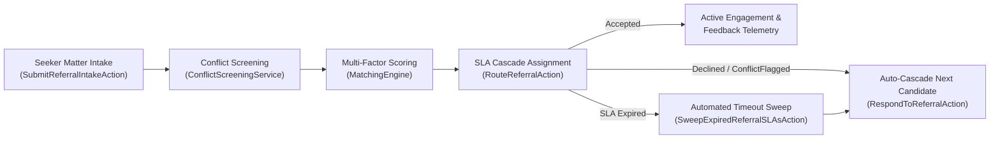

<p align="center">
  <picture>
    <source media="(prefers-color-scheme: dark)" srcset="https://github.com/MemberJunction/MJ/raw/main/MJ_logo_dark.png">
    <source media="(prefers-color-scheme: light)" srcset="https://github.com/MemberJunction/MJ/raw/main/MJ_logo.webp">
    
  </picture>
</p>

<h1 align="center">BizApps Referrals</h1>

<p align="center">
  <strong>Professional referral, verified member directory, conflict screening, and SLA cascade routing for the <a href="https://github.com/MemberJunction/MJ">MemberJunction</a> platform</strong>
</p>

<p align="center">
  <a href="#what-this-is--and-is-not">What this is</a> &middot;
  <a href="#installation">Install</a> &middot;
  <a href="#how-it-works">How it works</a> &middot;
  <a href="#what-you-get">What you get</a> &middot;
  <a href="#actions--operations">Actions</a> &middot;
  <a href="#angular-components--custom-forms">Angular UI</a> &middot;
  <a href="#metadata--seed-data">Metadata</a>
</p>

<p align="center">
  
  
  
  
  <a href="./LICENSE"></a>
</p>

---

Professional associations — bar associations, CPA societies, medical boards, engineering institutes, and trade networks — routinely manage member referrals through static directories, spreadsheets, or manual staff email chains. **BizApps Referrals** ("Find a Lawyer / Find a Pro") turns that workflow into a **verified, conflict-screened, SLA-governed referral engine** packaged as a single **MemberJunction Open App**.

Seekers describe their matter in plain language or structured filters; the matching engine scores eligible professionals across practice-area hierarchy, verified jurisdiction admissions, capacity headroom, and historical SLA responsiveness; conflict parties are screened before matter details are exposed; and deterministic SLA cascades automatically re-route declined, conflicted, or expired offers to the next-best candidate.

---

## What This Is — and Is Not

| ✅ This is | ❌ This is not |
|---|---|
| A **verified member directory & referral routing engine** (`__mj_BizAppsReferrals`) | A general-purpose CRM or lead-gen ad marketplace |
| **Explainable multi-factor matching** (`MatchingEngine`) across practice hierarchy, jurisdiction, capacity, and SLA history | An opaque black-box ranking widget with no audit trail |
| **Conflict-of-interest & SLA cascade governed** — `ConflictScreeningService`, `CascadeRoutingService`, and `SweepScheduler` | A manual "email 3 members and hope someone replies" listserv |
| **Tri-persona Angular workspace** — Seeker Intake, Member Pro Lead Inbox, and Association Ops Telemetry | A static read-only directory page |
| **Open App native** — composes cleanly with `BizApps Common` (Person/Org) and `BizApps Tasks` (follow-ups & escalations) | A siloed vertical database duplicating master people and tasks |

---

## Installation

BizApps Referrals is a [MemberJunction Open App](https://github.com/MemberJunction/MJ/tree/main/packages/OpenApp). Install it into any MJ environment using the [MJ CLI](https://github.com/MemberJunction/MJ/tree/main/packages/MJCLI):

```bash
mj app install https://github.com/MemberJunction/bizapps-referrals
```

This single command:

1. Fetches `mj-app.json` and validates MJ version compatibility (`>=6.2.1 <7.0.0`)
2. Resolves dependencies: [BizApps Common](https://github.com/MemberJunction/bizapps-common) and [BizApps Tasks](https://github.com/MemberJunction/bizapps-tasks)
3. Creates the `__mj_BizAppsReferrals` schema and deploys all 10 tables via Skyway migrations
4. Syncs application, action, practice-area, jurisdiction, and referral-tier metadata
5. Installs and wires `@mj-biz-apps/referrals-server` and `@mj-biz-apps/referrals-ng`

### Managing an installed app

```bash
mj app list                           # See installed apps
mj app info mj-bizapps-referrals      # Show details and version
mj app upgrade mj-bizapps-referrals   # Upgrade to latest release
mj app disable mj-bizapps-referrals   # Temporarily disable
mj app enable mj-bizapps-referrals    # Re-enable
mj app remove mj-bizapps-referrals    # Uninstall (--keep-data to preserve schema)
```

---

## How It Works



1. **Intake & Screening**: A `ReferralRequest` captures matter summary, practice area, jurisdiction, urgency, budget band, and `ConflictCheckParty` records.
2. **Scoring & Ranking**: `MatchingEngine` evaluates active `ProfessionalProfile` records on practice-area match (exact + ancestor), verified `ProfessionalJurisdiction` standing, capacity (`ActiveCount < MaxActiveReferrals`), `ReferralTier` priority weight, and historical SLA responsiveness, emitting explainable `MatchRationaleJSON`.
3. **Deterministic Cascade**: `CascadeRoutingService` offers the referral to Candidate #1 with a computed `SLADeadlineAt`. If the professional declines, flags a conflict, or lets the SLA expire (`SweepScheduler` / `SweepExpiredReferralSLAsAction`), the system automatically advances `RouteSequence` to Candidate #2.

---

## What You Get

### 10 Database Tables (`__mj_BizAppsReferrals` schema)

| Category | Tables | Purpose |
|---|---|---|
| **Taxonomy & Tiers** | `PracticeArea`, `Jurisdiction`, `ReferralTier` | Hierarchical practice-area tree, geographic/bar jurisdictions, and SLA/cascade tier policies |
| **Directory & Credentials** | `ProfessionalProfile`, `ProfessionalPracticeArea`, `ProfessionalJurisdiction` | Member profiles linked to `Person`/`Organization`, practice proficiencies, capacity caps, and verified license admissions |
| **Intake & Screening** | `ReferralRequest`, `ConflictCheckParty` | Seeker matter intake, urgency/budget metadata, and opposing/related parties for conflict checks |
| **Routing & Outcomes** | `ReferralAssignment`, `ReferralFeedback` | Sequential cascade offers with `MatchScore`, `MatchRationaleJSON`, SLA deadlines, and post-referral outcome ratings |

### 7 TypeScript Packages

| Package | NPM Name | Role |
|---|---|---|
| **Entities** | `@mj-biz-apps/referrals-entities` | CodeGen-generated strongly-typed entity classes and Zod schemas |
| **Core** | `@mj-biz-apps/referrals-core` | Pure domain engines: `MatchingEngine`, `ConflictScreeningService`, `CascadeRoutingService`, `ReferralTelemetry`, validation |
| **Entities Server** | `@mj-biz-apps/referrals-entities-server` | Authoritative server entity subclasses (`ConflictCheckPartyServerEntity`, `ProfessionalProfileServerEntity`, `ReferralRequestServerEntity`) |
| **Actions** | `@mj-biz-apps/referrals-actions` | Server `BaseAction` implementations + isomorphic `BaseRemotableOperation` client/server operations |
| **Server** | `@mj-biz-apps/referrals-server` | Server bootstrap (`LoadBizAppsReferralsServer`), `SweepScheduler`, and lifecycle probe endpoints |
| **Angular** | `@mj-biz-apps/referrals-ng` | Tri-persona Explorer application (`LoadBizAppsReferralsClient`) and `BaseFormPanel` custom entity form hero panels |
| **Integration Tests** | `@mj-biz-apps/referrals-integration-tests` | End-to-end lifecycle tests covering seeding, matching, conflict rejection, SLA timeout sweeps, and cascades |

---

## Actions & Operations

Every core workflow is exposed both as a MemberJunction Action (`@mj-biz-apps/referrals-actions`) and an isomorphic `BaseRemotableOperation`:

| Action / Operation | Purpose |
|---|---|
| `SubmitReferralIntakeAction` / `SubmitReferralIntakeOperation` | Creates a `ReferralRequest` + `ConflictCheckParty` rows and optionally triggers immediate matching & routing |
| `MatchProfessionalsAction` / `MatchProfessionalsOperation` | Scores and ranks eligible professionals with explainable `MatchRationaleJSON` |
| `RouteReferralAction` / `RouteReferralOperation` | Dispatches the next `ReferralAssignment` in sequence with an SLA deadline |
| `RespondToReferralAction` / `RespondToReferralOperation` | Atomically records `Accepted`, `Declined`, or `ConflictFlagged` and auto-cascades on non-acceptance |
| `SweepExpiredReferralSLAsAction` / `SweepExpiredReferralSLAsOperation` | Marks expired `Offered` assignments as `TimedOut` and cascades to the next ranked candidate |

---

## Angular Components & Custom Forms

`@mj-biz-apps/referrals-ng` registers a full Explorer application (**Referrals**) built exclusively with `--mj-*` semantic light/dark design tokens:

- **`ReferralsSeekerIntakeComponent`** (*Seeker Intake*): Natural-language matter intake bar, practice/jurisdiction/urgency filters, trust & SLA KPI strip, and ranked professional match cards with verified credential badges and match rationale.
- **`ReferralsProInboxComponent`** (*Pro Lead Inbox*): Incoming referral queue with live SLA countdown timers, `ConflictCheckParty` screening list, one-click `Accept` / `Flag Conflict` / `Decline` actions, and capacity controls.
- **`ReferralsOpsTelemetryComponent`** (*Ops Telemetry*): Association executive KPI strip, `Active Referral Dispatch Telemetry` table with cascade controls, and `Supply-Demand Gap Matrix`.
- **Custom Entity Forms (`BaseFormPanel`)**:
  - `ReferralRequestHeroPanel` — intake status, conflict screening summary, and `Candidate Cascade Ladder`
  - `ProfessionalProfileHeroPanel` — bar/license verification audit, capacity & routing policy, and historical acceptance/rating metrics

---

## Metadata & Seed Data

Reference metadata is managed declaratively via `mj sync` under [`metadata/`](./metadata):

- [`metadata/practice-areas/`](./metadata/practice-areas) — Default legal practice-area taxonomy
- [`metadata/jurisdictions/`](./metadata/jurisdictions) — State & federal jurisdictions
- [`metadata/referral-tiers/`](./metadata/referral-tiers) — `STANDARD`, `PRIORITY`, and `PRO_BONO` SLA/cascade tiers
- [`metadata/action-categories/`](./metadata/action-categories) & [`metadata/actions/`](./metadata/actions) — Action metadata registrations
- [`metadata/applications/`](./metadata/applications) — Explorer `Referrals` application and nav-item definitions

---

## Development & Testing

```bash
pnpm install
pnpm run build          # Build all @mj-biz-apps/referrals-* packages via Turborepo
pnpm run test           # Run unit tests across all packages
```

See [`mj-app.json`](./mj-app.json) for Open App manifest configuration and [`LICENSE`](./LICENSE) for BUSL-1.1 licensing details.
